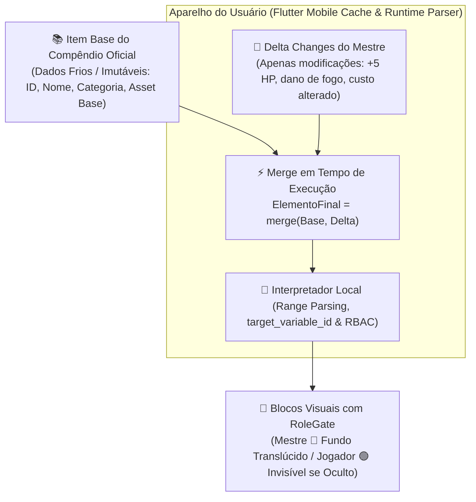

# ArcanaVTT — Módulo 12: Gerenciamento de Compêndio, Herança Delta, Interpretador Universal & Áudio P2P

---

## 🏛️ 7. Arquitetura Modular de Compêndio (As 5 Categorias Universais, Herança Delta & Esqueletos de Dados)

O **Compêndio** funciona como a biblioteca mecânica central e reutilizável de dados da campanha e do universo do jogo. Ele é estruturado para garantir **consumo nulo de banda, latência zero em celulares Android e armazenamento ultraleve no Cloudflare D1/SQLite** através do modelo de **Herança Delta**, **Blocos Modulares No-Code** e um **Interpretador em Tempo de Execução (*Smart Runtime Parser*)**:



---

### 📚 7.1. As 5 Categorias Universais & Rígidas do Compêndio

Todo e qualquer sistema de RPG cadastrado no ArcanaVTT (oficial, próprio ou comunitário) é obrigatoriamente estruturado sobre estas **5 categorias universais fixas e imutáveis**:

1. **🧪 Itens:** Poções de cura, elixires, rações de viagem, tochas, cordas, gazuas, ferramentas de ofício, munições, suprimentos e consumíveis em geral.
2. **⚔️ Equipamentos:** Armas brancas (corte, impacto, perfuração), armas de fogo e de distância, armaduras (leves, médias, pesadas), escudos, vestes, trajes e acessórios mágicos (anéis, amuletos, mantos, cintos), vinculados a **slots corporais de equipamento** estilo RPGs clássicos (*Exiled Kingdoms*).
3. **🐉 Seres:** Bestiário completo de criaturas, monstros, ameaças, aliados da guilda, PNJs de cidades, animais, entidades sobrenaturais e chefes de masmorra.
4. **✨ Poderes:** Magias arcanas/divinas, dons sobrenaturais, técnicas de combate, habilidades ativas, habilidades passivas e rituais.
5. **📜 Pistas:** Fragmentos de documentos, cartas cifradas, itens de enigma, segredos investigativos, mapas parciais e relíquias narrativas de lore.

---

### 📊 7.2. Filosofia de Dados: Esqueleto Enxuto & Interpretador Inteligente (*Runtime Parser*)

Para evitar o inchaço do banco SQLite local e da nuvem Cloudflare D1 com dezenas de colunas especializadas, adotamos a regra arquitetural:

> **"Banco de Dados Primitivo e Enxuto $\longleftrightarrow$ Interpretador Local Poderoso no Cliente (Flutter / Dart)."**

#### 🎯 Regra Geral Universal: `target_variable_id` e Range Parsing
Todo efeito mecânico executável carrega o identificador exato da variável da ficha do personagem (`target_variable_id`), a fórmula de dados/valores brutos com cálculo automático de **Range Numérico `{ min, max }`**, e o tipo de operação matemática (`operation: "add" | "sub" | "set"`).

```json
// 1. Esqueleto: 🧪 Itens (Consumíveis, Poções, Ferramentas)
{
  "id": "item_pocao_cura_maior",
  "name": "Poção de Cura Maior",
  "category": "itens",
  "sub_type": "Consumível / Alquimia",
  "base_asset_id": "svg_potion_large",
  "is_all_hidden": false, // Se true, o cartão inteiro recebe contorno em vermelho forte
  "blocks": {
    "bloco_aparencia": { "label": "Descrição", "type": "text", "value": "Líquido vermelho cintilante.", "is_visible": true },
    "bloco_efeito": { 
      "label": "Efeito de Cura", 
      "type": "dice_effect", 
      "dice_formula": "2d6 + 4", 
      "parsed_range": { "min": 6, "max": 16 }, 
      "target_variable_id": "hp_current", 
      "operation": "add", 
      "is_visible": true 
    },
    "bloco_tempo_uso": { "label": "Ativação", "type": "text", "value": "1 Ação", "is_visible": true },
    "bloco_cargas": { "label": "Doses", "type": "charges", "max_charges": 1, "current_charges": 1, "consume_on_empty": true, "is_visible": true },
    "bloco_peso": { "label": "Carga", "type": "number", "value": 1, "is_visible": true },
    "bloco_custo": { "label": "Preço", "type": "currency", "value": "50P", "is_visible": true }
  }
}

// 2. Esqueleto: ⚔️ Equipamentos (Estilo RPG Clássico / Exiled Kingdoms)
{
  "id": "eq_espada_aco_runica",
  "name": "Espada de Aço Rúnica",
  "category": "equipamentos",
  "equip_slot": "Mao_Principal", // Slots: Cabeca, Peitoral, Luvas, Calcas, Botas, Mao_Principal, Mao_Secundaria, Capa, Amuleto, Anel_1, Anel_2, Cinto
  "base_asset_id": "svg_sword_long",
  "is_all_hidden": false,
  "blocks": {
    "bloco_tipo": { "label": "Categoria", "value": "Arma Branca (Corte 1M)", "is_visible": true },
    "bloco_dano": { 
      "label": "Dano Base", 
      "dice_formula": "1d8 + 3", 
      "parsed_range": { "min": 4, "max": 11 }, 
      "damage_type": "Físico", 
      "target_variable_id": "target_hp_current",
      "operation": "sub",
      "is_visible": true 
    },
    "bloco_peso": { "label": "Slots de Carga", "value": 2, "is_visible": true },
    "bloco_efeito_oculto": { 
      "label": "Encantamento Secreto", 
      "dice_formula": "1d6", 
      "parsed_range": { "min": 1, "max": 6 }, 
      "damage_type": "Fogo", 
      "target_variable_id": "target_hp_current",
      "operation": "sub",
      "is_visible": false // Fundo vermelho translúcido na visão do Mestre
    }
  }
}

// 3. Esqueleto: 🐉 Seres (Criaturas / NPCs / Entidades)
{
  "id": "npc_guardiao_cripta",
  "name": "Guardião da Cripta",
  "category": "seres",
  "base_asset_id": "svg_token_skeleton_warrior",
  "is_all_hidden": false,
  "blocks": {
    "bloco_atributos": { "label": "Atributos", "value": { "corpo": 4, "mente": 2, "espirito": 1 }, "is_visible": false },
    "bloco_vida": { "label": "Vida / Ânima Máxima", "value": 28, "target_variable_id": "hp_max", "is_visible": false },
    "bloco_defesa": { "label": "Defesa Passiva", "value": 3, "is_visible": false },
    "bloco_ataques": { "label": "Ataques", "value": "Golpe de Alabarda (1d10+2)", "is_visible": true },
    "bloco_fraqueza": { "label": "Fraqueza Oculta", "value": "Vulnerável a dano de Fogo e Sagrado", "is_visible": false }
  }
}

// 4. Esqueleto: ✨ Poderes (Magias / Habilidades / Rituais)
{
  "id": "pow_rajada_chamas",
  "name": "Rajada de Chamas",
  "category": "poderes",
  "base_asset_id": "svg_spell_fireball",
  "is_all_hidden": false,
  "blocks": {
    "bloco_custo": { "label": "Custo de Energia", "value": "3 Pontos de Ânima / Mana", "target_variable_id": "anima_current", "operation": "sub", "is_visible": true },
    "bloco_alcance": { "label": "Alcance", "value": "9 metros", "is_visible": true },
    "bloco_duracao": { "label": "Duração", "value": "Instantâneo", "is_visible": true },
    "bloco_efeito": { 
      "label": "Dano em Área", 
      "dice_formula": "2d6", 
      "parsed_range": { "min": 2, "max": 12 }, 
      "damage_type": "Fogo",
      "target_variable_id": "target_hp_current",
      "operation": "sub",
      "is_visible": true 
    }
  }
}

// 5. Esqueleto: 📜 Pistas (Segredos / Relíquias / Lore)
{
  "id": "clue_diario_cultista",
  "name": "Página Rasgada do Diário",
  "category": "pistas",
  "base_asset_id": "svg_scroll_letter",
  "is_all_hidden": false,
  "blocks": {
    "bloco_resumo": { "label": "Aparência", "value": "Um pergaminho amarelado com manchas de cinza", "is_visible": true },
    "bloco_lore_secreta": { "label": "Texto Cifrado", "value": "A senha da cripta corresponde ao ano de fundação (1482)", "is_visible": false },
    "bloco_solucao": { "label": "Gatilho de Enigma", "value": "Senha do cofre: 1-4-8-2", "is_visible": false }
  }
}
```

---

### 🎨 7.3. Padronização de Assets Vetoriais (*Asset Standardization*)

- **Economia Extrema de Memória:** O ArcanaVTT não armazena arquivos pesados para cada variação de item.
- **SVGs Fixos por Tipo Base:** O aplicativo possui uma biblioteca interna de vetores transparentes universais (ex: `svg_potion_small`, `svg_potion_large`, `svg_sword`, `svg_axe`, `svg_shield`, `svg_ring`, `svg_scroll`, `svg_book`).
- **Customização Dinâmica por CSS/Cores:** O Mestre pode estilizar dinamicamente a cor da linha vetorial, o fundo e o brilho (*Glow*) do asset diretamente no editor da Oficina sem gerar arquivos binários no banco de dados.

---

### 🔒 7.4. Governança por Cargo (RBAC) & Sistema Visual de Destaque de Blocos

1. **Leitura Obrigatória de Cargo (*RoleGate*):**
   - O aplicativo lê o cargo do usuário autenticado na campanha (`Mestre`, `Assistente de Mestre`, `Jogador`, `Espectador`).
2. **Padrão Cromático dos Blocos:**
   - **Blocos Visíveis (`is_visible: true`):** Texto renderizado normalmente sem destaque no fundo.
   - **Blocos Invisíveis (`is_visible: false`):**
     - *Visão do Mestre / Assistente:* Fundo das letras destacado com um **vermelho vivo de alta transparência / translúcido** acompanhado de ícone de cadeado `🔒`, permitindo leitura clara do segredo.
     - *Visão do Jogador:* O bloco é **100% filtrado da árvore de renderização Flutter**, sem gerar espaços vazios ou pistas visuais de dados ocultos.
3. **Elemento 100% Oculto (`is_all_hidden: true`):**
   - Caso todo o elemento esteja oculto para a mesa, o **contorno/borda do cartão** recebe um **vermelho forte e vibrante**.
4. **Modal de Descrição Completa (`[ 📜 Descrição Completa ]`):**
   - Cada card possui o botão que abre o modal expandido contendo todas as variáveis, lore, efeitos mecânicos e blocos daquele elemento em detalhes.
5. **Navegação de Retorno:**
   - O botão `[← Voltar]` no cabeçalho do Compêndio retorna diretamente para a **Aba 5 (Oficina do Mestre) dentro do Modal Geral da Campanha**.

---

### 🧠 7.5. Herança Delta (Semi-Dependente) & Limites de Armazenamento

1. **Otimização Extrema no SQLite/D1:**
   - Ao modificar um item do compêndio, o sistema armazena apenas:
     - `parent_id`: Identificador do item oficial base;
     - `delta_changes`: Objeto JSON contendo estritamente os campos alterados (ex: `{"name": "Espada de Fogo", "blocks": { "bloco_dano": { "value": "1d8+1d6 fogo" } }}`).
2. **Merge em Tempo de Execução no Flutter:**
   - $\text{ElementoFinal} = \text{merge}(\text{ElementoPai}, \text{DeltaChanges})$.
   - Reduz o consumo de banco em mais de **90%**.
3. **Limites Rígidos:**
   - Limite de até **100 Homebrews por Categoria por Sistema de RPG** (100 Itens, 100 Equipamentos, 100 Seres, 100 Poderes, 100 Pistas = 500 Homebrews totais por Sistema).
4. **Distribuição P2P Mesh & Governança de Nuvem:**
   - Deltas de campanhas trafegam **diretamente entre os celulares dos membros da mesa via P2P Mesh**.
   - Para manter o banco Cloudflare D1 seguro e enxuto, o upload para o catálogo público da plataforma só é liberado após **aprovação manual de um Admin ou Superadmin**.

---

## 📜 9. Sistema de Regras, Fichas & Mecânicas (Motor Modular e Agnóstico)

O ArcanaVTT integra um motor de regras modular capaz de suportar nativamente qualquer sistema de RPG de licença livre ou mecânicas customizadas:

1. **Atributos & Especializações Modulares:**
   - Atributos configuráveis com pools de dados, margens de sucesso, críticos e falhas configuráveis.
2. **Recursos Vitais, Relógio & Descansos:**
   - Gestão de barras de recurso (Vida, Energia, Mana, Sanidade, Ânima) com suporte a aprovação do Mestre (`auto_approve_actions`).
   - Relógios narrativos e contadores de progresso visuais (*Progress Clocks*).
3. **Economia & Níveis de Moedas:**
   - Suporte a moedas personalizadas (Pratas, Peças de Ouro, Créditos) com débito automático em lojas e cenas de diálogo.
4. **Diário de Campanha & Registro Permanente:**
   - Linha do tempo oficial com crônicas, missões e árvores de notas interligadas.

---

## 🎵 10. Gestão de Áudio & Ambiência P2P

- **Controle pelo Mestre:** Disparo de trilhas musicais e efeitos sonoros (*SFX*) associados às cenas e gatilhos de tensão.
- **Consumo Inteligente (Google Drive Pattern / URLs):** Áudios não sobrecarregam o servidor; são referenciados via links externos ou transmitidos via **streaming direto P2P do Mestre para os Jogadores**.
- **Ajustes Individuais:** Mixer de Áudio dedicado de 4 canais nas Configurações com controle independente de volume por usuário.
