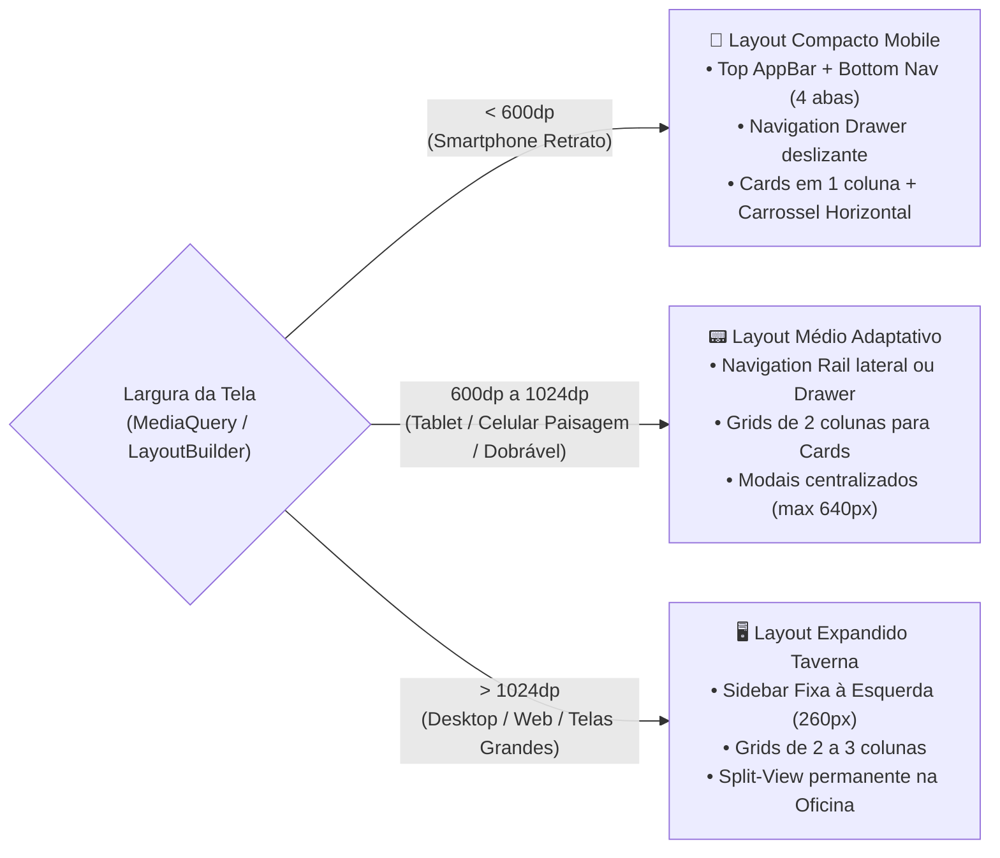

# 🎨 ArcanaVTT — Guia Geral de Estética, Design System & Ergonomia Adaptativa

Este documento estabelece a **Regra Geral de Estética e Design System** do **ArcanaVTT**. Todas as telas, modais, componentes, ícones, animações e layouts responsivos desenvolvidos em Flutter devem obedecer estritamente às especificações abaixo para garantir unidade visual (*Dark Fantasy Heráldico*), acessibilidade tátil e performance cravada em **60 FPS**.

---

## 🏛️ 1. Identidade Visual & Filosofia Estética ("Taverna Arcana")

O ArcanaVTT combina a sobriedade imersiva de um **Dark Fantasy Heráldico** com a precisão moderna de interfaces de alta densidade (inspirado na ergonomia do *Discord* e na atmosfera nobre dos mockups originais da Taverna).

1. **Contraste Profundo com Realce Nobre:** Fundos noturnos profundos (obsidiana/azul-abissal) onde apenas os elementos interativos, títulos e estados ativos brilham em tons de **Ouro Arcano / Âmbar**.
2. **Zero Poluição Visual:** Bordas finas de `1px`, superfícies translúcidas ou em camadas sutis, evitando sombras pesadas em favor de contornos iluminados (*Glow Border*) quando um item está selecionado.
3. **SVG-First & Vetores Dinâmicos:** 100% da iconografia de interface e de assets base utiliza vetores `.svg` (estilo *Lucide / Tabler Icons* com traço `1.75px` ou `2.0px`), estilizados em tempo de execução via `ColorFilter` / CSS sem duplicar arquivos.
4. **Acessibilidade & Conforto Ocular:** Projetado para sessões de RPG de 3 a 6 horas contínuas sem fadiga visual, oferecendo suporte nativo a **3 Temas Visuais** e **Escala Tipográfica Dinâmica (80% a 150%)**.

---

## 🎨 2. Paleta de Cores Oficial & Os 3 Temas da Taverna

Todo componente deve consumir cores através do `ThemeExtension` / `ColorScheme` do Flutter, nunca utilizando hexadecimais fixos (*hardcoded*) fora do arquivo central de tema.

### 🌑 2.1. Tema 1: Modo Escuro Heráldico (Padrão Oficial)

| Token Semântico | Hexadecimal | Aplicação / Uso Principal |
| :--- | :---: | :--- |
| **`bgCanvas`** | `#080811` | Fundo base global das telas (com vinheta/gradiente radial sutil `#121024` no topo). |
| **`bgSurface`** | `#131322` | Superfície padrão de Cards, Painéis, Gavetas Laterais (Drawers) e Bottom Bar. |
| **`bgElevated`** | `#18182C` | Modais sobrepostos, Bottom Sheets, Dropdowns e Cards em estado de Hover/Foco. |
| **`bgInput`** | `#0D0D18` | Fundo de campos de texto, caixa de código de 6 dígitos e prompt do terminal. |
| **`borderSubtle`** | `#25253E` | Borda padrão de `1px` para cards, divisores de seção e inputs inativos. |
| **`borderActiveGold`** | `#D4A34B` | Moldura de seleção ativa (ex: cena selecionada na Oficina, aba ativa, input focado). |
| **`accentGoldPrimary`** | `#E5B758` | Cor primária de ação (botões principais como *"Entrar"*, ícones em destaque, títulos heráldicos). |
| **`accentGoldSecondary`** | `#B8862D` | Gradiente inferior de botões dourados, bordas ornamentadas e estados pressionados. |
| **`accentGoldMuted`** | `#2A2218` | Fundo translúcido de pílulas/itens de menu selecionados (`rgba(212, 163, 75, 0.14)`). |
| **`textPrimary`** | `#F4F4F8` | Títulos principais, nomes de heróis, valores de rolagem e textos de leitura primária. |
| **`textSecondary`** | `#9CA3AF` | Subtítulos, descrições narrativas, lore resumida e labels de formulário. |
| **`textMuted`** | `#64687A` | Placeholders de input, carimbos de data/hora, contadores inativos e dicas secundárias. |
| **`textOnGold`** | `#090910` | Texto escuro de alto contraste aplicado **sobre** botões preenchidos em dourado (`#E5B758`). |

### 🔋 2.2. Tema 2: Economia de Bateria OLED (Pretos Puros)

Projetado para telas AMOLED/OLED em dispositivos móveis, desligando fisicamente os pixels de fundo:

* **`bgCanvas`:** `#000000` (Preto absoluto).
* **`bgSurface`:** `#07070C` (Quase preto para leve distinção de card).
* **`bgElevated`:** `#0F0F17`.
* **`borderSubtle`:** `#1E1E30` (Garante a delimitação geométrica já que não há diferença de luminância no fundo).
* *Acentos Dourados e Semânticos permanecem idênticos ao Tema Padrão.*

### ☀️ 2.3. Tema 3: Alto Contraste (Luz Solar / Acessibilidade)

Projetado para leitura sob iluminação externa intensa ou usuários com baixa visão:

* **`bgCanvas`:** `#05050A` | **`bgSurface`:** `#101020`.
* **`borderSubtle`:** `#4B5563` (Bordas visivelmente demarcadas com `1.5px`).
* **`accentGoldPrimary`:** `#FFD166` (Ouro luminoso de máximo contraste).
* **`textPrimary`:** `#FFFFFF` (Branco puro) | **`textSecondary`:** `#E2E8F0`.

---

## 🚦 3. Cores Semânticas, Cargos (RBAC), Status de Mesa & Segredos

### 🛡️ 3.1. Insígnias de Cargo (Badges RBAC)

* ⚔️ **Jogador (`rolePlayer`):** Esmeralda `#10B981` (Fundo `#062E22`, Borda `#059669`).
* 🛡️ **Assistente de Mestre (`roleAssistant`):** Ciano Arcano `#06B6D4` (Fundo `#082F38`, Borda `#0891B2`).
* 🧙‍♂️ **Mestre / GM (`roleMaster`):** Ouro Real `#E5B758` (Fundo `#2D2310`, Borda `#D4A34B`).
* 🛡️ **Admin (`roleAdmin`):** Carmesim Nobre `#F43F5E` (Fundo `#310B15`, Borda `#E11D48`).
* 👑 **Superadmin (`roleSuperadmin`):** Roxo Astral & Ouro `#A855F7` com borda `#E5B758` (Fundo `#241038`).

### 🎲 3.2. Estados de Sessão da Campanha

* 🔴 **AO VIVO (`statusLive`):** `#EF4444` (com indicador pulsante suave).
* 🟢 **FREE TIME (`statusFreeTime`):** `#10B981` (verde constante).
* 📅 **AGENDADA (`statusScheduled`):** `#F59E0B` (âmbar/dourado informativo) ou `#3B82F6` (azul calendário).

### 🔒 3.3. Governança Visual de Blocos no Compêndio (Regra RBAC)

* **Bloco Visível (`is_visible: true`):** Fundo transparente, texto em `textPrimary`.
* **Bloco Oculto (`is_visible: false` — Visão Exclusiva Mestre/Assistente):**
  * Fundo das letras/bloco em **Vermelho Vivo Translúcido** (`#EF4444` com opacidade `18%` / `#2E1218`) + borda esquerda `2px solid #EF4444` + ícone `🔒`.
* **Elemento 100% Oculto (`is_all_hidden: true`):**
  * O contorno completo do Card recebe borda `2px solid #FF2E4C` (Vermelho vibrante de alerta de segredo).

### 🔢 3.4. Semáforo RGB de Puzzles (Modelo 3 — Cofres & Senhas)

* 🔴 **Acima da Meta (`hintHigher`):** `#EF4444` (Borda e brilho interno vermelho).
* 🟢 **Valor Exato (`hintExact`):** `#10B981` (Borda e brilho interno verde esmeralda).
* 🔵 **Abaixo da Meta (`hintLower`):** `#3B82F6` (Borda e brilho interno azul safira).
* 🏆 **Combinação 100% Correta:** `#E5B758` (Moldura dourada radiante).

---

## ✒️ 4. Tipografia & Escala Dinâmica

O sistema tipográfico utiliza **3 famílias de fontes** complementares, todas suportando o multiplicador global de escala do usuário ($S \in [0.80, 1.50]$):

1. **Fonte Heráldica de Títulos (`fontDisplay` — *Cinzel* ou *Playfair Display*):**
   * Usada exclusivamente em: Saudações do Hero Header (*"SALVE, AVENTUREIRO!"*, *"BEM-VINDO, AVENTUREIRO"*), títulos de telas, nomes de campanhas em destaque, cabeçalhos de modais e títulos de cards nobres (em *UPPERCASE* com `letterSpacing: 0.8` ou *Title Case* solene).
2. **Fonte de Interface e Leitura (`fontSans` — *Inter* ou *Plus Jakarta Sans*):**
   * Usada em: Menus, botões, descrições de cards, chats, fichas de personagem, formulários, tags e textos longos de diário. Máxima legibilidade em telas pequenas.
3. **Fonte Monoespaçada / Técnica (`fontMono` — *JetBrains Mono*):**
   * Usada em: Código de 6 dígitos do *Quick Join* (`K8F2M9`), fórmulas de rolagem (`2d6 + 4`), contadores numéricos de PV/Ânima, coordenadas de Grid `(X: 12, Y: 08)` e **Modelo 6 (Terminal & Hacking)** (com suporte a troca para fontes de *Runas Arcanas*).

### 📏 Tabela de Escala Tipográfica Base ($S = 1.0$)

| Estilo | Família | Tamanho Base | Peso (`FontWeight`) | Altura de Linha |
| :--- | :--- | :---: | :---: | :---: |
| **`displayHero`** | *Cinzel* | `24sp` – `28sp` | `Bold (700)` | `1.25` |
| **`headlineModal`** | *Cinzel* | `18sp` – `20sp` | `SemiBold (600)` | `1.30` |
| **`titleCard`** | *Cinzel* / *Inter* | `15sp` – `16sp` | `SemiBold (600)` | `1.35` |
| **`bodyRegular`** | *Inter* | `14sp` | `Regular (400)` | `1.50` |
| **`bodyCompact`** | *Inter* | `12sp` – `13sp` | `Regular (400)` | `1.40` |
| **`labelBadge`** | *Inter* / *Mono* | `11sp` | `Medium (500)` | `1.20` |

---

## 📐 5. Formas, Geometria, Bordas & Elevação

Para manter a fidelidade exata às referências visuais (`FrontLogin.jpg`, `Front1.jpg`, `print.png` e `print2.png`):

### 🔲 5.1. Raios de Borda (`BorderRadius`)

* **Cards Principais, Painéis e Modais (`radiusCard`):** `16px` (`BorderRadius.circular(16)`).
* **Contêineres Internos, Inputs e Botões Principais (`radiusControl`):** `10px` a `12px` (`BorderRadius.circular(12)`).
* **Caixas de Ícone Quadradas (`radiusIconBox`):** `10px` (ex: o quadrado escuro/dourado de `40x40px` que envolve o ícone de espada, livro ou coroa dentro dos cards).
* **Itens de Navegação Ativos, Tags `#` e Dock Flutuante (`radiusPill`):** `999px` (Formato de pílula completa para itens selecionados na Sidebar/Drawer ou badges de status).
* **Bottom Sheets Mobile (`radiusSheetTop`):** `24px` apenas nos cantos superiores (`BorderRadius.vertical(top: Radius.circular(24))`).

### 🖼️ 5.2. Tratamento de Bordas e Estados Visuais

* **Card Padrão:** Fundo `bgSurface` (`#131322`), borda `1px solid #25253E`.
* **Card / Item Selecionado ou Ativo:**
  * Borda muda para `1.5px solid #D4A34B` (Dourado).
  * Fundo recebe leve tintura âmbar (`#1C1924` ou `rgba(212, 163, 75, 0.08)`).
* **Estados Vazios (*Empty States* — ex: "Nenhuma campanha ainda"):**
  * Contêiner com **borda tracejada (`DashedBorder`)** de `1px` na cor `#2A2A45`, ícone centralizado de `36px` em `textMuted`, título em *Cinzel* `16sp` branco e subtítulo explicativo em `textSecondary`.
* **Botão Primário Dourado (CTA Principal):**
  * Preenchimento em gradiente linear suave (`#E8BE62` $\rightarrow$ `#CE9B3E`), texto em `#090910` (`FontWeight.w600`), altura mínima de `48px` e raio de `10px`.

---

## 📱 6. Posicionamento Adaptativo & Ergonomia Responsiva

Embora o ArcanaVTT seja **Mobile-First (Android)**, seu layout adapta-se automaticamente a 3 classes de tela (*Breakpoints* via `LayoutBuilder`), preservando a mesma árvore lógica de modais:

### 🧭 6.1. Regras de Adaptação de Navegação e Ícones

1. **Top AppBar (Cabeçalho Global — Altura `56dp`):**
   * **Esquerda:** Botão do Menu Lateral (Drawer) no mobile + Logo Heráldico do ArcanaVTT (quadrado dourado de `36x36dp` com ícone de Coroa/Dados em `#090910` + título *"ARCANA VTT"* em *Cinzel*).
   * **Direita:** Ícone SVG de Notificações (`bell.svg`) com badge numérico em ouro/carmesim + Avatar clicável do usuário (abre o Perfil Social estilo Discord).
2. **Navegação Principal (Bottom Bar vs. Sidebar Fixa):**
   * **Em Telas `< 600dp` (Mobile):** Exibida como **Bottom Navigation Bar** fixa na base (`64dp` de altura) com os 4 destinos principais (*Início [`shield.svg`], Campanhas [`swords.svg`], Sistemas [`scroll.svg`], Comunidades [`users.svg`]*). O ícone ativo recebe cor `#E5B758` e indicador luminoso superior/pílula.
   * **Em Telas `>= 900dp` (Tablet Paisagem / Desktop):** Converte-se automaticamente na **Sidebar Fixa à Esquerda (`260dp` de largura)** idêntica aos mockups `Front1.jpg` e `print2.png`, com itens em formato de pílula contornada em dourado quando ativos e rodapé fixo contendo o botão de Ajuda (`info.svg`) e Logout (`log-out.svg`).
3. **Posicionamento de Ícones dentro de Cards:**
   * **Cards de Resumo / Hub (ex: Campanhas, Sistemas, Oficina):** Ícone SVG de `22dp` em dourado `#E5B758` posicionado à esquerda dentro de um *IconBox* quadrado (`42x42dp`, fundo `#1C1B2E`, raio `10px`), com o Título em *Cinzel* e a descrição em 2 linhas imediatamente à direita.
   * **Cards de Campanha Completos:** Banner panorâmico no topo (`aspectRatio: 16/7`) com badge de status (ponto luminoso esmeralda para *AO VIVO* ou âmbar para *FREE TIME*) flutuando no canto superior esquerdo sobre fundo escuro semi-transparente (`backdropFilter`), avatar da mesa sobreposto na transição do banner e botão de ação ocupando `100%` da largura inferior do card.
4. **Zonas de Toque (*Touch Targets*) & Safe Areas:**
   * Todo ícone clicável ou botão deve possuir área mínima de toque de **`48x48dp`**, mesmo que o vetor visual tenha `20dp` ou `24dp`.
   * Respeito obrigatório ao `SafeArea` (recortes de câmera/*notch* no topo e barra de gestos do Android na base).

---

## 🛡️ 8. Diretrizes de Iconografia SVG-First & Proibição Absoluta de Emojis

### 🚫 8.1. Política de Tolerância Zero a Emojis (Zero Emojis)
* **Proibição Absoluta:** É terminantemente proibido o uso de caracteres unicode de emojis (ex: ⚔️, 🛡️, 👑, 📜, 🚨, 🔞, 🚪, etc.) em qualquer elemento visual da interface do ArcanaVTT (botões, listas, modais, headers, chips ou badges).
* **Justificativas de Engenharia & Estética:**
  1. *Identidade Heráldica:* Emojis coloridos quebram a atmosfera *Dark Fantasy / Ouro Antigo* e transmitem aparência amadora.
  2. *Fragmentação de Plataforma:* Emojis possuem renderizações visualmente discrepantes entre Android (Google Noto), iOS (Apple Color Emoji), Windows (Segoe UI Emoji) e Linux.
  3. *Incompatibilidade com Temas:* Emojis não herdam variáveis de cor dinâmica (`currentColor`, tema escuro, modo alto contraste solar ou OLED preto puro).

### 📐 8.2. Iconografia SVG-First (Pacote Oficial de Ícones)
* **Formato Vetorial SVG Puro:** Todos os ícones de ação, status, navegação e heráldica são arquivos SVG reais (`flutter_svg` / `GuiaDeEstetica/assets/icons/*.svg`), baseados na coleção refinada Lucide adaptada ao contexto medieval fantástico.
* **Geometria & Grid Padrão:**
  * Traço uniforme: `stroke-width: 1.75px` a `2px`.
  * Pontas e junções: `stroke-linecap="round"` e `stroke-linejoin="round"`.
  * Grades dimensionais:
    * Micro-ícones (badges, tags, chips): `14x14px` ou `16x16px`.
    * Ícones de botões e campos de input: `18x18px` ou `20x20px`.
    * Ícones de navegação e menu principal: `22x22px` ou `24x24px`.
    * Ícones de destaque de modal (IconBox central): `32x32px` a `40x40px`.

### 🖼️ 8.3. Formato das Imagens Estáticas & Renders (WebP)
* **WebP para Renders e Imagens Estáticas:** As telas de prévia, mockups conceituais de modais, banners e ilustrações da plataforma utilizam o formato **WebP** (`.webp`).
* **Vantagens Técnicas:** O formato WebP garante compressão superior com perda quase imperceptível, resolução nítida e elimina problemas de interpretação de entidades XML estritas em navegadores e webviews móveis.

---

## ✨ 7. Animações, Micro-Interações, Haptics & Performance (60 FPS)

### ⚡ 7.1. Durações e Curvas Padrão

* **Micro-interações (Toque em botão, troca de aba, toggle On/Off):** `150ms`, curva `Curves.easeOutCubic`.
* **Abertura de Modais, Bottom Sheets e Gavetas:** `220ms` a `250ms`, curva `Curves.fastOutSlowIn`.
* **Transição entre Telas do Dock:** *Cross-fade* suave + leve deslocamento vertical (`4dp`) em `180ms`.
* **Toque Tátil Visual (*Press Scale*):** Ao pressionar qualquer Card clicável ou Botão Primário, aplicar redução elástica sutil de escala para `0.98` vinculada ao **Haptic Feedback** configurado pelo usuário (*Desativado, Suave, Médio, Intenso*).

### 🛑 7.2. Regra de Redução de Movimento & Orçamento de 60 FPS

1. **Toggle "Redução de Movimentos e Animações":**
   * Quando ativado nas Configurações (ou via `MediaQuery.disableAnimations`), todas as durações de transição caem para `0ms` (troca instantânea) e efeitos de pulso/partículas são desativados.
2. **Proibição de `BackdropFilter` (Blur) em Listas Roláveis:**
   * O efeito de desfoque de vidro (*Glassmorphism*) é permitido **apenas** em cabeçalhos fixos ou fundo de modal único estático. É estritamente proibido dentro de `ListView` / `GridView` ou no *Grid Tático 2D* para nunca derrubar a taxa de quadros abaixo de **60 FPS**.
3. **Isolamento de Repintura (`RepaintBoundary`):**
   * O canvas do *Grid Tático 2D*, o rolador de dados e os indicadores pulsantes (`🔴 AO VIVO`) devem ser envelopados em `RepaintBoundary` com construtores `const` em todos os widgets estáticos.
